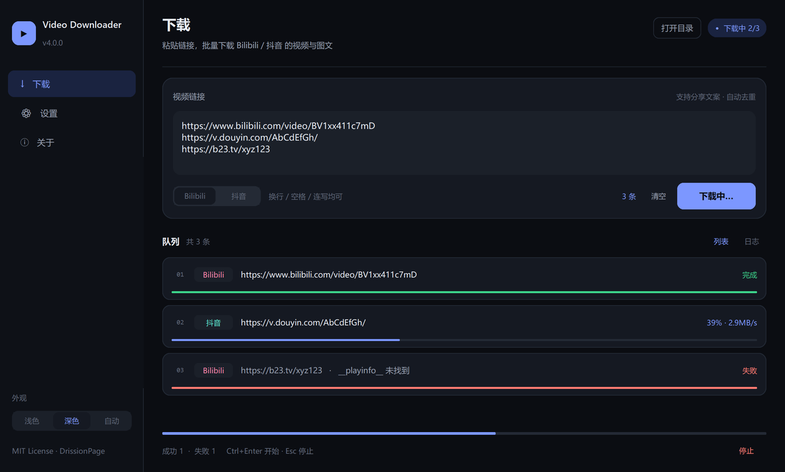
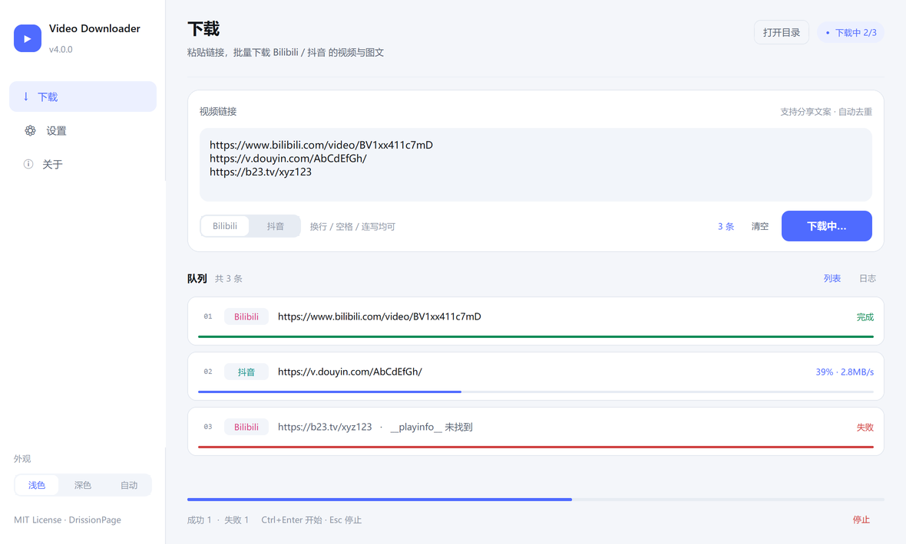

[Uploading README-new.md…]()
# Video Downloader

多平台视频 / 图文下载工具，桌面 GUI，基于 DrissionPage 驱动本机 Chrome。
已支持 **Bilibili** 与 **抖音**，架构预留小红书等平台扩展。

| 深色 | 浅色 |
| --- | --- |
|  |  |

> **声明**：本项目仅供技术交流与学习使用。下载需要登录对应平台账号，使用过程可能存在账号风险，请自行评估。请遵守各平台用户协议，勿将下载内容用于商业用途。

---

## 三步跑起来

**1. 装 Python 3.10 或更高**

到 https://www.python.org/downloads/ 下载安装。

> ⚠️ 安装第一屏一定要勾 **Add Python to PATH**，不然后面 `run.bat` 找不到 Python。

**2. 装 Chrome 或 Edge**

程序靠它登录和取数据。两个有一个就行（Edge 是 Windows 自带的，一般不用另装）。

**3. 双击 `run.bat`**

它会自动检查 Python、自动装依赖（第一次约 1 分钟）、然后启动界面。
出错时窗口不会闪退，会停住给你看报错。

启动后：

```
选平台 → 粘贴链接 → 点「开始下载」
   ↓ 没登录过
自动弹出浏览器停在登录页 → 你扫码/输密码登录 → 登录成功自动开始下载
   ↓ 登录过
直接开始，浏览器缩到任务栏后台跑
```

---

## 常见问题

**双击 run.bat 一闪就没 / 提示找不到 Python**

Python 没装好，或者装的时候没勾 `Add Python to PATH`。重装一次并勾上，或者手动开命令行跑：

```bat
pip install -r requirements.txt
python main.py
```

**提示 pip install 失败**

网络问题。换个网络，或先设代理再跑：

```bat
set https_proxy=http://127.0.0.1:端口
run.bat
```

**卡在"等待登录"**

浏览器窗口被最小化或关掉了。程序会自动重新拉起；如果一直不行，关掉程序重开。

**登录了但下载失败**

先看程序下方日志。常见是链接失效、或该内容需要更高权限（会员/付费）。日志里会写清楚卡在哪一步。

**下载的文件在哪**

默认 `C:\Users\<你>\video_downloader\`：

| 内容 | 路径 |
| --- | --- |
| Bilibili 视频 | `bili_video/` |
| Bilibili 分P | `bili_video/<标题>/18_分P标题.mp4` |
| 抖音视频 | `dy_video/` |
| 抖音图文 | `dy_photo/<标题>/01.jpg …` |

设置页可以改成别的目录。

---

## 功能

- **Bilibili**
  - 分P / 合集按集下载：填 `18-20`、`1,3,5`、`7-`，只下你点名的集
  - 每一集在队列里独立一行、独立进度
  - 自动分离视频流与音频流，用 ffmpeg 无损合并
- **抖音**
  - 自动区分视频与图文，不用手动选
  - 支持直接粘贴分享文案（`7.68 复制打开抖音…`）
  - 图文按张下载，文件名带序号
- **通用**
  - 一次粘贴多条链接；下载中还能继续粘贴 → 「加入队列」
  - 开始下载后自动清空输入框，方便粘下一批
  - 简化链接自动补全（不带 `https://`、`www.` 也能识别）
  - 双主题（浅色 / 深色 / 跟随系统），切换立即生效
  - 登录后浏览器自动最小化，全程不打扰
  - `Ctrl+Enter` 开始、`Esc` 停止
  - 插件系统，新平台一个文件

---

## 使用说明

### Bilibili 分P / 合集

输入框下方有个开关：

```
☐ 这些链接是合集 / 分P，我要按集数下载（仅 Bilibili）
```

- **不勾** → 每条链接按当前这一集下载，行为和普通视频一样
- **勾上** → 展开明细，每条链接一行：

```
☑ 按集数   1. bilibili.com/video/BV1xx…   [18-20]
☐ 按集数   2. bilibili.com/video/BV1yy…   [     ]
```

勾中「按集数」的才选集，右边填集数；留空表示整个合集。
一集会拆成队列里的一行，各自有进度。

### 抖音图文

不用任何额外操作。粘贴链接后程序自动判断：

```
识别为图文（images，9 张）
```

图片存到 `dy_photo/<标题>/01.jpg …`，顺序和页面翻页一致。

### 队列

下载过程中输入框仍可用，按钮会变成「加入队列」，点了就排到当前批次后面。
进度条上方会显示 `2/5` 这样的计数。

---

## 目录结构

```
main.py                 启动入口
run.bat                 一键启动（自动装依赖）
core/
  browser.py            DrissionPage 封装、登录检测、标签管理
  config.py             配置读写（%APPDATA%）
  http_client.py        HTTP 下载、重试、断点
  media.py              文件命名、ffmpeg 合并
  platform_base.py      平台基类
  platforms/
    bilibili.py         Bilibili 实现
    douyin.py           抖音实现
    xiaohongshu.py      小红书（预留）
gui/
  app.py                应用主体、队列调度
  views/                下载页 / 设置页 / 关于页
  widgets.py            卡片、主题切换、分段控件
plugins/                插件示例
tests/test_core.py      纯逻辑测试，python tests/test_core.py
changes/                v4→v10 每一步的 diff
```

---

## 配置

写在 `%APPDATA%\VideoDownloader\config.json`，重启保留：

| 键 | 说明 |
| --- | --- |
| `download_dir` | 下载目录 |
| `browser_path` | Chrome/Edge 路径，留空用系统默认 |
| `appearance` | `light` / `dark` / `system` |
| `open_after_done` | 下载完是否打开目录 |

---

## 开发

```bat
pip install -r requirements.txt
python main.py

python tests/test_core.py     :: 纯逻辑测试，不碰网络
```

新增平台：复制 `core/platforms/xiaohongshu.py` 的模板，实现 `match_url` / `login_url` / `is_logged_in` / `download`，再注册到 `core/platforms/__init__.py`。

---

<details>
<summary><b>更新记录（点击展开）</b></summary>

### v10 — 分P/合集兼容 + 引导重做

- 合集（`ugc_season`）与分P（`pages`）分开处理，合集按各自 bvid 打开
- 找不到选集列表时明确报错，不再静默回退成单集
- 优先用公开接口取分P列表，不打开页面
- 队列一集一行，独立进度
- UI 加总开关，勾了才展开明细

### v9 — 按条指定集数

- 每条链接独立填 `18-20`，不再只能整批全下
- 平台切换时占位提示跟着换

### v8 — 队列续跑与来源校验

- 下载中可继续粘贴 → 「加入队列」
- 平台选错时给出确认弹窗
- 登录后清理多余标签

### v7 — 先粘贴再登录

- 输入框一开始就可用，不用先点「启动浏览器」
- 未登录时自动开浏览器并等待，登录完自动继续

### v6 — 容错、并发、可诊断

- 短链跳转后用最终 URL 重新解析 id
- 详情未命中时刷新重试
- 失败时输出页面状态（风控页 / 登录墙 / 已删除）
- 图片三路并发

### v5 — 取数可靠性

- 详情包按 `aweme_id` 校验，丢弃推荐流预取的相邻作品
- 图文字段依次尝试 `images` / `image_post_info.images` / `image_list`
- 图片去重按路径段，不再硬截断

### v4 — 界面重做

- 双主题、左侧导航、卡片式队列
- `Ctrl+Enter` 开始、`Esc` 停止

更早的变化见 `changes/` 下的 diff 文件。

</details>
