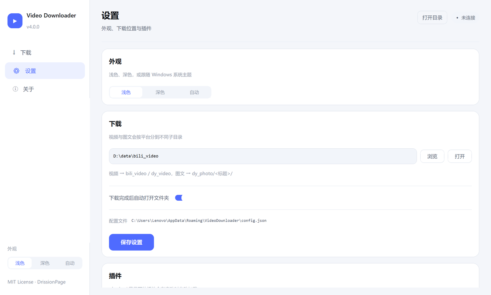

# Video Downloader

多平台视频下载工具，基于 DrissionPage 浏览器自动化 + CustomTkinter 桌面界面。

已支持 **Bilibili** 与 **抖音**（视频 / 图文），架构预留小红书等平台扩展。

> **声明**：本项目仅供技术交流与学习使用。下载功能需要登录对应平台账号，使用过程中可能存在账号风险，请知悉并自行评估。请遵守各平台相关用户协议，勿将下载内容用于商业用途。

深色：


浅色：


## v4 更新

**双主题**：浅色 / 深色 / 跟随系统，侧边栏和设置页都能切换，改完立即生效并记住选择
（写入 `%APPDATA%\VideoDownloader\config.json` 的 `appearance`）。所有颜色都用
`(浅色, 深色)` 成对定义，切换时由 CustomTkinter 重绘，不重建界面。

**布局重做**：左侧导航 + 顶部页头 + 内容区；输入区是一张独立卡片，任务列表改成一行一张
卡片，卡片底部那条细线就是该任务的进度（蓝=进行中、绿=完成、红=失败）。字号只保留
21/15/13/12/11 五档，颜色收敛为一个靛蓝强调色。

**细节**：`Ctrl+Enter` 直接开始下载、`Esc` 停止；输入区实时显示识别到的条数；状态、失败原因、
实时速度（`39% · 2.9MB/s`）都直接写在队列里。

## v5 修正（取数可靠性）

v4 的抖音链路是"导航页面 → 监听接口 → 捡到哪个包用哪个"，这决定了它必然受缓存、
预取、懒加载影响。v5 只改取数方式，不改变"需要登录"这个前提。

| # | 改动 | 解决的问题 |
| --- | --- | --- |
| 1 | 详情包按 `aweme_id` 校验，非目标包丢弃并记录 | 推荐流预取的相邻作品被误当成当前作品（批量时张冠李戴） |
| 2 | 监听改为"持续收包 + 20s 截止"，不再 `wait(12)` 一次定生死 | 首屏慢/请求晚到就被判失败 |
| 3 | 图文依次尝试 `images` → `image_post_info.images` → `image_list` | 顶层 `images` 为 null 时被误判成"非图文" |
| 4 | 图文兜底改为读已渲染 DOM + "连续两次无新增才停" | 缓存命中不发请求、懒加载未触发导致的漏图 |
| 5 | 图片去重键改为 `tos-cn-i` 之后的路径段，且不再 `[:total]` 硬截断 | 同一张图多变体被算成多张、再截断时挤掉真图 |
| 6 | 总页数只接受 1..30 的合理数字 | `999+`、时长文本把页数放大到上限，白滑 29 次 |
| 7 | `download_addr` 仅在无 `play_addr` 时兜底，结果标记 `watermarked` | 静默存下带水印的分享版 |
| 8 | 每个任务独立标签页（`gui/app.py`） | 上一条的 SPA 状态/缓存/监听残留串到下一条 |
| 9 | `download(..., on_log=)` 全链路诊断 | 失败时能看出断在"取包/字段/采集/下载"哪一步 |

新增 5 项纯逻辑测试（字段路径、aweme_id 提取、水印兜底、页数上限、去重稳定性），
`python tests/test_core.py` 共 23 项全通过。

## v6 修正（容错、并发、可诊断）

v5 解决了"取数方式"，v6 处理剩下的三类问题：短链/重试、失败原因不可读、图片串行太慢。

| # | 改动 | 解决的问题 |
| --- | --- | --- |
| 1 | 短链跳转后用最终 URL 重新解析 `aweme_id` | `v.douyin.com/xxx` 打开前没有 id，短链场景会退化成"捡第一个包" |
| 2 | 详情未命中时刷新重试一次（截止 12s × 2） | 首屏偶发不发请求，不必人工重跑 |
| 3 | 失败时输出页面状态：风控页/登录墙/已删除/纯 CSR | 不再统一报"页面解析也未命中" |
| 4 | 文件名优先取作品文案 `desc` | 页面标题元素经常拿不到，退化成 `video_1` |
| 5 | 图片并发下载（3 路），`files` 仍按序号返回 | 9 张图串行约 9s，现在约 3-4s |
| 6 | `requests.Session` 改为线程局部 | 并发共享连接池会出现偶发错误响应 |
| 7 | DOM 采集补 `srcset`、HTML 实体解码 | `&amp;`、懒加载 `data-src` 导致的漏图 |
| 8 | 图集字段兼容 `download_url_list` | 部分图集只有下载地址列表 |

新增 3 项测试（文案命名、去重键变体、页面状态判定），共 26 项通过。

## v7 更新（交互：先粘贴，再登录）

v6 之前必须先点「启动浏览器」才能拿到可编辑的输入框，而"需要登录"这件事
只写在 README 里。v7 把顺序倒过来，并把登录前置条件直接写在输入框下面。

| # | 改动 | 解决的问题 |
| --- | --- | --- |
| 1 | 输入框从启动就可用，不再等浏览器 | 用户的第一动作是粘贴，不是先点按钮 |
| 2 | 单一「开始下载」按钮：未登录时自动开浏览器、等登录、再下载 | 少一步操作，也不会出现"点了没反应" |
| 3 | 输入框下新增两行说明：需要登录 / 仅个人使用 | 登录是硬前提，必须在动手前告知 |
| 4 | 占位提示在**第一次输入时**消失（原来只靠 FocusIn） | 键盘输入、Tab 聚焦时提示词会留在框里 |
| 5 | 占位文本不会被退格吃掉 | 误按 BackSpace 会删掉提示，之后无法恢复 |
| 6 | 等待登录时可点「停止」取消，链接保留 | 登录卡住只能强杀程序 |
| 7 | 已登录时复用现有窗口，不重新 launch | 重开浏览器会丢登录态 |

`_is_empty()` 现在把"占位中"也算空，修掉了 `_set_input_enabled` 与
`_on_focus_out` 里"提示词存在但被当成有内容"的连锁问题。

## v8 更新（队列续跑 / 合集 / 来源校验）

| # | 改动 | 解决的问题 |
| --- | --- | --- |
| 1 | 队列改成"边跑边收"：下载中可继续粘贴，按钮变「加入队列」 | 原来下载中锁死输入，只能等这一批跑完 |
| 2 | 加入队列后自动清空输入框 | 手动清空容易漏，下一条链接接不上 |
| 3 | 粘贴来源校验：链接平台与当前选择不一致时弹窗确认 | 选错平台后整批失败，用户不知道原因 |
| 4 | 一批结束有失败时弹窗汇总前 4 条原因 | 失败原因只躺在日志里，容易被忽略 |
| 5 | Bilibili 合集 / 分P 多选：按链接勾选，默认第一条 | `?p=7` 只代表第 7 集，合集需要单独声明 |
| 6 | 勾了合集但不是合集 → 提示并回退单集 | 误勾导致整条失败 |
| 7 | 登录完成后关闭多余标签页，只留一个空白页 | 登录页和任务标签堆在一起很乱 |
| 8 | 新增 `browser_path` 配置，可改用 Edge 等 Chromium | 默认只能走系统 Chrome |
| 9 | `download(..., options=)` 增加平台选项通道 | 平台特有开关（合集）没地方传 |

合集下载按 `__INITIAL_STATE__.videoData.pages` 取分P列表，逐集解析 `__playinfo__`，
失败只跳过该集并在日志里标注，最后给出 `成功/总数`。

## v9 更新（按条指定分P范围）

v8 只能"整部合集全下"，v9 改成按链接点名集数，并把范围写回 `p=`：

| # | 改动 | 解决的问题 |
| --- | --- | --- |
| 1 | 勾选行右侧新增范围输入框，支持 `3-7` / `1,3,5` / `7-` | 只想要合集里几集时，不必整部下完再删 |
| 2 | 范围按**每条链接**独立保存，默认只勾第一条 | 一次粘 10 条、其中 2 条要选集，可以分别指定 |
| 3 | 空范围 = 该合集全部；非法写法在开始前弹窗拦下 | 静默变成"全下"或"下当前集"都会误导 |
| 4 | 点名的分P不存在只提示并跳过 | 用户记错集数时，不该整条失败 |
| 5 | 文件名前缀改用真实分P号（`03_标题.mp4`） | v8 用序号，`3-7` 会变成 `01..05` 对不上集数 |
| 6 | 提示词随平台切换（B 站 / 抖音两套） | 切到 B 站后还显示"粘抖音分享文案" |

平台差异：范围只对 Bilibili 生效；抖音没有分P概念，切到抖音时该区域自动隐藏。

## v10 更新（分P/合集兼容 + 引导重做）

v9 有三个问题：合集和分P被当成一种、勾选语义容易误读、填了范围却只下一个时不给原因。

| # | 改动 | 解决的问题 |
| --- | --- | --- |
| 1 | 新增 `_episodes()` 统一层：优先分P（`pages`），没有则读合集（`ugc_season`） | B 站"合集"是多条不同 BV，`?p=N` 对它无效，v9 会误判成单集 |
| 2 | 合集按条目的 bvid 打开，分P 才拼 `?p=N` | 之前合集只能下到第一个 |
| 3 | 找不到选集时**报错**，不再静默回退单集 | "填了 18-20 只下一个"的直接原因 |
| 4 | 每集开始前写日志 `[2/3] 第 19 集：标题` | 跑到哪一集、卡在哪一集，一眼能看到 |
| 5 | 结果带上 `2/3 集（1 集失败）` | 部分失败不再看起来像成功 |
| 6 | UI 加总开关，勾了才展开明细；行内改成「按集数」复选框 | "勾选=下载"的误读；空白框没有引导 |

勾选语义现在分两层，不再混：

```
☐ 这些链接是合集 / 分P，我要按集数下载（仅 Bilibili）   ← 关：全部按单集下
   1. bilibili.com/...   ☑ 按集数   [18-20]
   2. bilibili.com/...   ☐ 按集数   [     ]（禁用）
```

## 功能

- 批量下载：换行、空格、`|`、逗号、顿号分隔都行，分享文案直接粘
- 简化链接自动补全，裸 `BV1xx` / `av170001` 也认，连写的多条链接会拆开
- **Bilibili**：解析 `__playinfo__` 拿 DASH 流，音视频分离下载后用 ffmpeg 合并；无音轨视频自动跳过合并
- **抖音**：自动识别视频 / 图文；图文按页面顺序保存，同图多地址时优先原图
- 流式写盘 + 长度校验 + 备用 CDN 回退，失败自动重试
- 可切换的运行日志，每条任务带耗时
- 插件系统：下载前后钩子、URL 过滤、设置页自定义控件
- 配置持久化（外观、下载目录、完成后行为）

## 环境要求

- Windows 10 / 11
- Python 3.10+
- Chrome 浏览器

## 快速开始

Windows 上直接双击 `run.bat`：会检查 Python 与依赖，缺少时自动
`pip install -r requirements.txt`，然后启动程序。

命令行方式：

```bash
pip install -r requirements.txt
python main.py
```

首次启动后：选平台 → 粘贴链接 → 「开始下载」。若尚未登录，程序会自动打开 Chrome
并等待登录，登录完成后自动继续，不需要单独点「启动浏览器」。

## 使用流程

1. 在输入框下方选择平台（Bilibili / 抖音）
2. **先粘贴**一条或多条链接（输入框立即可用，无需先登录）
3. 点击「开始下载」：
   - 已登录 → 直接开始
   - 未登录 → 自动打开 Chrome 并停在登录页，状态栏显示「等待登录 · 剩余秒数」，
     登录成功后自动开始下载；登录期间可点「停止」取消，链接会保留
4. 队列里实时显示进度、速度与结果
5. **下载中想再加一批**：直接把新链接粘进输入框，按钮会变成「加入队列」，
   点击后自动清空输入并排到当前批次之后，当前任务结束就接着下载
6. **Bilibili 分P / 合集（两步走）**：
   - 先勾下面的总开关「这些链接是合集 / 分P，我要按集数下载」，勾了才展开明细
   - 明细里每条链接一行：左边「按集数」勾中才选集，右边填 `18-20` / `1,3,5` / `7-`；
     留空 = 该合集全部；不勾"按集数"的链接只下当前这一集
   - 分P 用 `?p=N` 打开；合集（`ugc_season`）用各自的 bvid 打开
7. 文件保存到：

| 内容 | 路径 |
| --- | --- |
| Bilibili 视频 | `<下载目录>/bili_video/` |
| Bilibili 分P | `<下载目录>/bili_video/<标题>/03_分P标题.mp4 …`（前缀是分P号） |
| 抖音视频 | `<下载目录>/dy_video/` |
| 抖音图文 | `<下载目录>/dy_photo/<标题>/01.jpg …` |

下载目录与外观可在「设置」页修改；环境变量 `BILI_DOWNLOADER_DIR` 优先级更高。

## 支持的浏览器

底层是 DrissionPage，走 Chrome DevTools 协议，所以**只支持 Chromium 内核**：

| 浏览器 | 支持 | 说明 |
| --- | --- | --- |
| Chrome | ✅ 默认 | 不配置直接用它 |
| Edge | ✅ | 在配置里填 `browser_path`，登录态独立 |
| 其他 Chromium（Brave / 360 等） | ✅ | 同上，需给绝对路径 |
| Firefox / Safari | ❌ | 没有 CDP，DrissionPage 不支持 |

配置文件 `%APPDATA%\VideoDownloader\config.json`：

```json
{ "browser_path": "C:\\Program Files (x86)\\Microsoft\\Edge\\Application\\msedge.exe" }
```

留空即使用系统默认 Chrome；路径无效会自动退回默认。



## 项目结构

```
video-downloader/
├── main.py                      # 入口（DPI 适配 + 启动 GUI）
├── run.bat                      # Windows 一键启动
├── core/
│   ├── browser.py               # 浏览器生命周期、登录检测、请求头
│   ├── config.py                # 配置读写（含 appearance）
│   ├── dp_tools.py              # cookie -> 请求头
│   ├── http_client.py           # 连接复用、重试、流式下载、进度
│   ├── jsonx.py                 # 页面内嵌 JSON 的安全提取
│   ├── media.py                 # ffmpeg 合并、文件命名
│   ├── models.py                # DownloadResult / Progress
│   ├── platform_base.py         # 平台基类
│   ├── plugin_base.py           # 插件基类
│   ├── urls.py                  # 链接提取（连写拆分 / 裸 BV 号）
│   └── platforms/
│       ├── __init__.py          # 平台注册表
│       ├── bilibili.py
│       └── douyin.py
├── gui/
│   ├── app.py                   # 主窗口、导航、事件总线、外观切换
│   ├── theme.py                 # 双主题色板与字号
│   ├── widgets.py               # 卡片 / 任务行 / 分段控件 / 主题开关
│   └── views/
│       ├── download_view.py     # 下载页（队列 / 日志切换）
│       ├── settings_view.py     # 设置页
│       └── about_view.py        # 关于页
├── plugins/
│   └── example_logger.py        # 示例：记录下载历史
├── tests/
│   └── test_core.py             # 纯逻辑回归（无需浏览器/网络）
├── docs/
├── requirements.txt
└── README.md
```

## 修复记录（相对初版）

| 问题 | 处理 |
| --- | --- |
| 链接连写时被并成一条，导致"粘三条只下一条" | 解析前按协议头拆分，逐条校验 |
| 裸 BV / av 号识别不了 | 支持并自动补全为完整链接 |
| `?p=2` 分 P 参数被丢掉 | 路径正则保留查询串 |
| 抖音图文用 `set` 存图片地址，顺序随机、去重不确定 | 按捕获顺序分组去重，组内选最高画质 |
| B 站媒体地址用正则抠 `"video":[...]`，依赖键相邻、空数组即失败 | 括号配平提取 `__playinfo__` 整块 JSON，按结构取值 |
| 抖音 HTML 兜底用非贪婪正则截断嵌套 JSON，会抓到无关 `url_list` | 配平解析 + `RENDER_DATA` 解码，失败显式报错 |
| 视频整块读入内存、失败留半截文件 | 流式分块落盘 + 长度校验 + `.part` 临时文件 |
| 候选地址 × 3 次串行重试，死链能耗十几分钟 | 只试前 3 个候选、每个最多重试 1 次；界面显示实时进度 |
| 工作线程直接操作 Tk 控件 | 统一 `queue` 事件总线，只有主线程更新 UI |
| B 站"找不到未登录入口 = 已登录"，页面没渲染完就误判 | 改为正向检测头像容器 |
| 重复启动泄漏 Chrome、登录超时直接退出程序 | 复用/关闭旧实例，超时回到未连接状态 |
| 插件钩子未接入、图文路径被拼成 `.mp4` | 钩子接上，`download()` 返回 `DownloadResult` |
| 同名视频互相覆盖 | 已存在时自动追加 `(2)` |
| 取 cookie 用空白标签页，登录态丢失 | `cookies(all_domains=True)` |
| 下载目录选成 `bili_video` 时再套一层同名目录 | 同名时不再嵌套 |

## 新增平台

1. 在 `core/platforms/` 下新建文件，继承 `PlatformBase`：

```python
from core.models import DownloadResult
from core.platform_base import PlatformBase


class ExamplePlatform(PlatformBase):
    name = "example"
    display_name = "示例"
    host_suffixes = ("example.com",)
    sub_folder = "example_video"

    def login_url(self) -> str:
        return "https://www.example.com/"

    def is_logged_in(self, page) -> bool:
        return bool(page.ele("css:.avatar"))

    def get_video_name(self, tab) -> str | None:
        return None

    def download(self, tab, url, headers, fallback_name, on_progress=None):
        ...
```

2. 在 `core/platforms/__init__.py` 里 import 并加入 `PLATFORMS` 列表。

URL 识别、批量解析、界面平台切换都会自动生效。

## 插件开发

在 `plugins/` 下新建文件，继承 `PluginBase`，启动时自动加载：

```python
from core.plugin_base import PluginBase


class MyPlugin(PluginBase):
    name = "我的插件"
    description = "示例"
    version = "1.0"

    def on_init(self, browser):
        ...

    def on_url_input(self, url: str) -> str:
        return url            # 返回空串可丢弃这条链接

    def on_download_complete(self, url, result, success):
        if success:
            print(result.path, result.kind)
```

## 测试

```bash
python tests/test_core.py
```

覆盖内嵌 JSON 解析、连写链接拆分、裸 BV 号、分享文案提取、域名匹配、
文件名清洗、抖音图文排序/去重、B 站媒体挑选与回退等纯逻辑，不需要浏览器与网络。

## 已知限制

- 平台页面结构或接口字段变化时，解析逻辑仍可能需要跟进适配
- 下载依赖登录态；未登录时可能只能拿到低清晰度或直接失败
- 小红书平台文件仍是占位实现，尚未注册

## License

MIT
